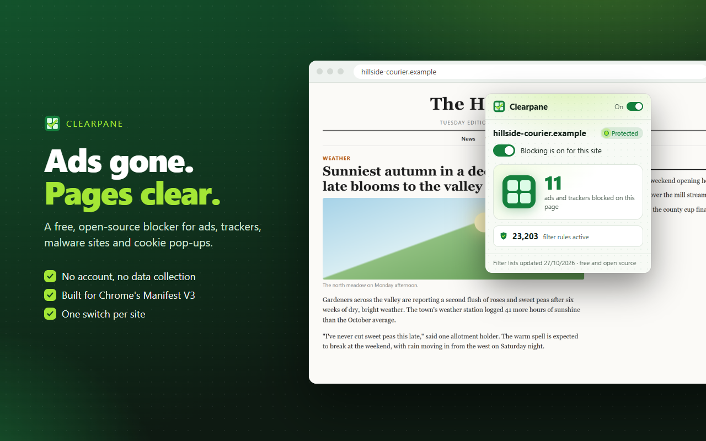

# Clearpane

**A free, open-source ad and tracker blocker for Chrome.** No accounts, no
data collection, no "acceptable ads" deals, no paid tier.

Clearpane blocks ads, trackers, malware sites and cookie pop-ups using the
same community filter lists that power the best blockers: EasyList,
EasyPrivacy, uBlock Origin's filters and Brave's lists. It's built for Chrome's
current extension platform (Manifest V3), so it keeps working after the
changes that pushed older blockers out of the Chrome Web Store.

<p align="center"></p>

## What it does

- **Blocks ad, tracker and malware requests** before they load, using
  Chrome's built-in blocking engine, so pages load faster and use less data.
- **Hides leftover ad boxes** so pages don't have empty gaps.
- **Fixes anti-adblock walls and annoyances** on many sites with small,
  site-specific scripts from the filter lists.
- **Hides cookie-consent pop-ups.**
- **One switch per site.** If a site breaks, turn Clearpane off for it in the
  popup. Turn it back on any time.
- **Private by design.** Everything runs inside your browser. Clearpane
  has no servers and sends nothing anywhere. See the [privacy policy](PRIVACY.md).

In testing on Chrome 156 it scored **95/100 on adblock-tester.com** (46/100
without it), and removed every visible ad slot on the CNN and Guardian
homepages. Details are in the [developer guide](docs/DEVELOPER.md#test-results-27-oct-2026-chrome-156-headless-fresh-profile).

## Install

- **Chrome Web Store:** coming soon.
- **From source:** [download this repository as a zip](https://github.com/oddlyclevertools/clearpane/archive/refs/heads/main.zip)
  and unzip it (or `git clone https://github.com/oddlyclevertools/clearpane`), open
  `chrome://extensions`, turn on **Developer mode**, click **Load unpacked**
  and choose the folder.

## How it compares

Clearpane is a Manifest V3 extension, so it works inside the limits
Chrome sets for every extension. It can't do everything a browser with
blocking built in can do (fingerprint protection, CNAME uncloaking), and a
few advanced filter types can't be expressed in Chrome's rule format. The
[developer guide](docs/DEVELOPER.md#known-limits-compared-with-brave-shields)
lists exactly what is and isn't supported.

## Problems and ideas

If a site breaks or an ad gets through, [open an issue](https://github.com/oddlyclevertools/clearpane/issues)
with the page address. Filter-list fixes are made upstream by the list
maintainers; Clearpane picks them up in its next release.

## Build it yourself

You need Node.js 22 or newer, and no npm packages:

```bash
node tools/build.mjs      # download the latest lists and convert them
node tools/package.mjs    # make the store zip in dist/
```

See the [developer guide](docs/DEVELOPER.md) for how the conversion works and
how to run the browser tests.

## Licence and credits

Clearpane's code is free software under the
[GNU General Public License v3.0 or later](LICENSE). The filter lists belong
to their volunteer maintainers and keep their own licences: see
[THIRD_PARTY_NOTICES.md](THIRD_PARTY_NOTICES.md). Clearpane is an
independent project and is not affiliated with Brave, uBlock Origin, EasyList
or any other filter-list project.
